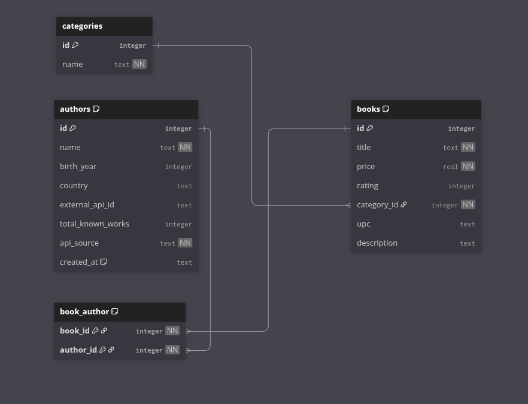

# 📚 Books to Scrape + Open Library — Pipeline de datos

> Challenge 4 · The Huddle · Python · BeautifulSoup · SQLite

Mini pipeline de datos de punta a punta: **scraping → enriquecimiento con API → persistencia → modelado → performance**, todo en un único notebook ejecutado: [`Challenge_4.ipynb`](Challenge_4.ipynb).

## 🔄 Pipeline

| Etapa | Qué hace | Resultado |
|---|---|---|
| 🕷️ **Scraping** | Recorre todas las categorías de [Books to Scrape](https://books.toscrape.com/) con paginación y entra a la página de cada libro | **50 categorías, 1000 libros** (título, precio, rating, UPC, descripción) |
| 🌐 **Enriquecimiento** | Busca cada título en la API de **Open Library** para obtener el autor y luego consulta sus datos | **404 autores** con ID externo, año de nacimiento, país y cantidad de obras |
| 🧱 **Persistencia** | Crea la base SQLite desde cero con DDL completo y la carga con DML | `books_challenge.db` |
| 📖 **Consultas** | 5 consultas comentadas, incluida la obligatoria por país | Tablas en el notebook |
| ⚡ **Performance** | Consulta deliberadamente lenta, medida antes y después de un índice | ~4x más rápida con el índice |

## 🗂️ Modelo de datos



- `categories` 1 ── N `books`
- `books` N ── N `authors`, mediante la tabla intermedia `book_author` con PK compuesta
- Índices en `books(category_id)`, `book_author(book_id)`, `book_author(author_id)`, `authors(external_api_id)` y `authors(country)`

El esquema también está en formato DBML ([`books_challenge.dbml`](books_challenge.dbml)) para abrirlo en [dbdiagram.io](https://dbdiagram.io).

## 🌐 Integración con la API

- **Fuente:** Open Library (`search.json` para el libro y el endpoint del autor para sus datos). Cada autor guarda `api_source` y `external_api_id` como prueba de origen.
- **Manejo de errores:** timeouts, errores HTTP (`raise_for_status`) y respuestas vacías. Si no hay coincidencia, el libro queda asociado a un autor `Unknown Author` y el caso se registra.
- **Cache:** diccionarios en memoria para libros y autores, que evitan llamadas repetidas a la API.
- **País:** Open Library no tiene un campo de nacionalidad, así que se infiere buscando gentilicios ("British", "American"…) en la biografía del autor.

### Limitaciones (honestas)

- **534 de 1000 títulos** no tuvieron coincidencia clara en Open Library. El catálogo de Books to Scrape mezcla títulos reales con títulos de ejemplo.
- El país solo pudo inferirse para **96 de 404 autores**, porque muchos no tienen biografía en la API. La consulta por país refleja esa cobertura parcial.

## 📖 Consultas incluidas

1. Libros con más de 3 estrellas por menos de £10
2. Autor con peor promedio de rating (mínimo 5 libros)
3. Categoría con mayor precio promedio
4. Top 5 autores con más libros
5. **Por país:** qué país produce más libros con rating mayor a 3 (`books → book_author → authors → GROUP BY country`)

## ⚡ Indexación y performance

La consulta lenta usa una subconsulta correlacionada sobre `book_author(author_id)`:

| Escenario | Plan de SQLite | Tiempo (mediana de 20) |
|---|---|---|
| Sin índice | `SCAN ba2`: recorre la tabla entera por cada libro | ~28 ms |
| Con índice | `SEARCH ba2 USING COVERING INDEX` | ~6 ms |

La explicación completa del cambio de plan está en el notebook.

## 🚀 Ejecutar

```bash
python -m venv .venv
source .venv/bin/activate        # Windows: .venv\Scripts\activate
pip install -r requirements.txt
```

Abrí `Challenge_4.ipynb` en VS Code o Jupyter. El scraping y la API necesitan internet; el notebook ya incluye los resultados ejecutados y la base generada (`books_challenge.db`).

## 🛠️ Stack

`Python` · `requests` · `BeautifulSoup` · `SQLite` · `pandas` · `Open Library API`
